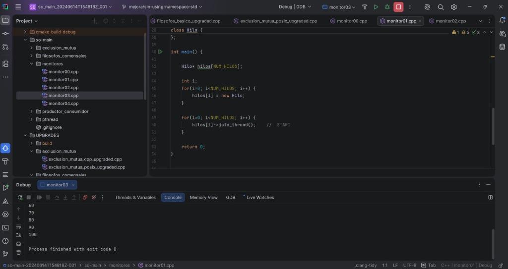
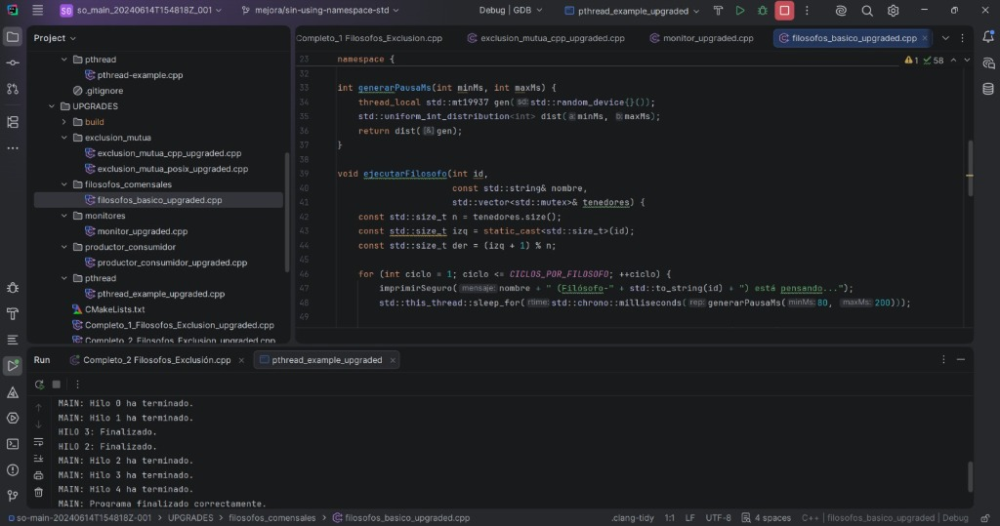
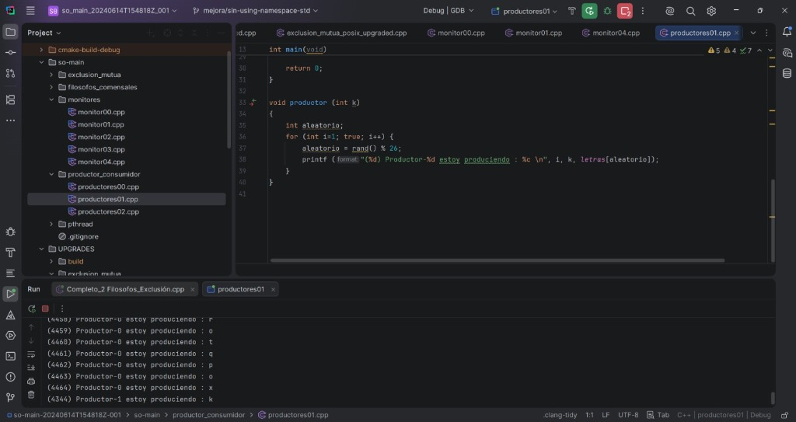
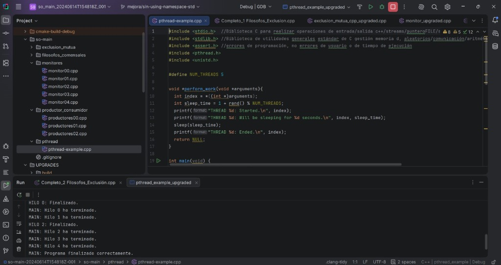
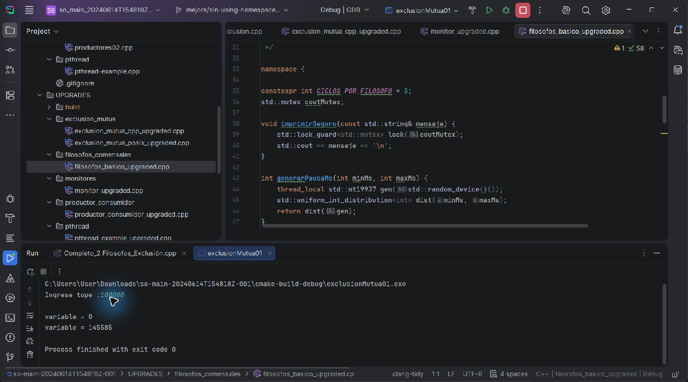
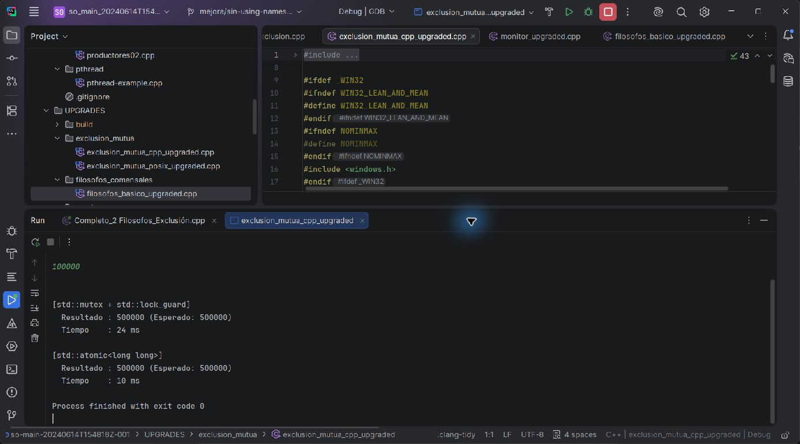
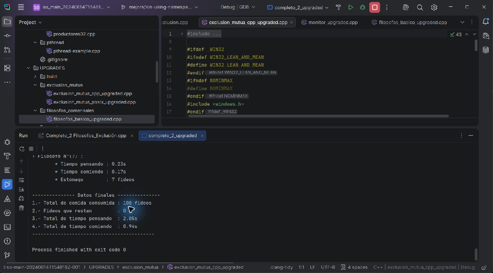
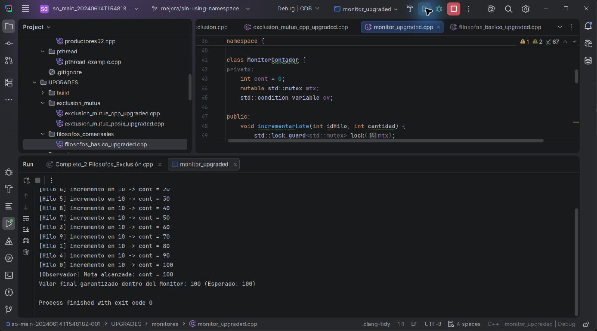
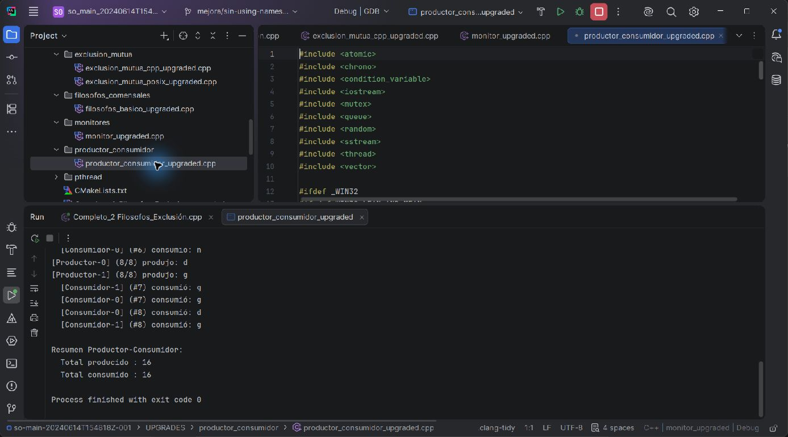

# Informe Técnico de Análisis Crítico, Reflexivo y Mejoramiento de Código

**Actividad 9 — Programación Concurrente y Sincronización en C/C++**

- **Curso:** Sistemas Operativos
- **Semestre:** 5
- **Docente:** Maribel Molina Barriga
- **Integrantes del equipo:**
  1. **GABRIEL ANDRE PAJUELO ARANIBAR**
  2. **Armando Manuel Enriquez Eguiluz**
  3. **Victor Gabriel Lupinta Flores**
  4. **Claudio Dax Zavala Salas**

---

## 1. Introducción y Metodología de Trabajo

El presente informe documenta la auditoría completa, análisis crítico y reingeniería de los códigos fuente entregados en la práctica de **Sistemas Operativos** sobre concurrencia. El equipo siguió una metodología en cuatro etapas:

1. **Inspección estática y compilación inicial:** Se revisaron los 19 archivos `.cpp` entregados y el `CMakeLists.txt` raíz, detectando de inmediato que el proyecto no compilaba porque todos los archivos con `main()` estaban asignados a un único ejecutable.
2. **Ejecución controlada de los códigos originales:** Una vez independizados los objetivos en CMake, se ejecutaron los módulos en CLion / MinGW GCC 15.2.0 para observar sus fallos reales en tiempo de ejecución (condiciones de carrera, bucles infinitos, punteros sin inicializar, desbordamientos y caracteres corruptos en consola Windows).
3. **Rediseño y mejora en `UPGRADES/`:** Se desarrollaron versiones corregidas aplicando C++17 moderno, RAII, sincronización libre de interbloqueos, manejo ordenado de memoria, eliminación de `using namespace std;` y soporte UTF-8.
4. **Validación y control de versiones:** Se recompilaron los **27 ejecutables** sin advertencias (`-Wall -Wextra -Wpedantic` en `UPGRADES/`) y se verificó su ejecución correcta bajo Git con ramas separadas por mejora.

---

## 2. Análisis Crítico, Reflexivo y Mejoras por Módulo

### 2.1 Los Filósofos Comensales
**Archivos analizados:** `filosofos00.cpp`–`04.cpp`, `Completo_1 Filosofos_Exclusion.cpp`, `Completo_2 Filosofos_Exclusión.cpp`  
**Archivos mejorados:**
- [filosofos_basico_upgraded.cpp](./UPGRADES/filosofos_comensales/filosofos_basico_upgraded.cpp)
- [Completo_1_Filosofos_Exclusion_upgraded.cpp](./UPGRADES/Completo_1_Filosofos_Exclusion_upgraded.cpp)
- [Completo_2_Filosofos_Exclusion_upgraded.cpp](./UPGRADES/Completo_2_Filosofos_Exclusion_upgraded.cpp)

#### Análisis crítico del código entregado
- **Progresión inicial (`filosofos00..04`):** Pasa de un `"Hola mundo!"` a ejecución secuencial (`01` y `02` con bucle infinito que impide ejecutar al segundo filósofo) y luego a `pthread` (`03` y `04`) con bucles infinitos sin tenedores ni sincronización de `printf`.
- **`Completo_1 Filosofos_Exclusion.cpp`:**
  1. **Condición de carrera en `fideos`:** En `main()`, cada hilo evalúa `while (fideos > 0)` e `if (fideos > 0)` fuera del `mutex`, permitiendo lecturas sucias concurrentes.
  2. **Métrica errónea de tiempo:** `tiempoComiendo += cantidad;` sumaba la cantidad de fideos como si fueran segundos, sin simular pausa al comer.
  3. **Riesgo de división por cero:** Si el usuario ingresaba `numFilosofos <= 0`, la división `totalEstomagos / numFilosofos` fallaba.
  4. **Ineficiencia aleatoria y consola mezclada:** Reconstruía `std::random_device` y `std::mt19937` en cada llamada y escribía en `std::cout` sin mutex.
- **`Completo_2 Filosofos_Exclusión.cpp`:**
  1. **Error grave de ciclo de vida de cerrojos:** En `tomarTenedores()`, se creaban `unique_lock<mutex> lockIzq` y `lockDer` locales. Al retornar la función, sus destructores **desbloqueaban inmediatamente los tenedores antes de comer**. Luego, `dejarTenedores()` volvía a llamar `.unlock()` sobre mutex que el hilo ya no poseía, generando **Comportamiento Indefinido**.
  2. **Desbordamiento de arreglo:** `tenedores` tenía tamaño fijo `5` e índice `id % 5`. Si el usuario ingresaba más de 5 filósofos, se producía acceso fuera de límites.
  3. **Validación ineficaz de `INT_MAX`:** `LimitFideMax(int fide)` comprobaba `fide > 2147483647` sobre un `int` de 32 bits, donde el desbordamiento ya había ocurrido al leer con `std::cin`.

#### Solución adecuada implementada
- Se encapsuló el plato compartido y se centralizó lectura/descuento en `intentarComer()` bajo `std::lock_guard<std::mutex>`.
- En `Completo_2_Filosofos_Exclusion_upgraded.cpp`, `tenedores` es un `std::vector<std::mutex>` dimensionado dinámicamente con `numFilos` (exigiendo `numFilos >= 2`) y protegido mediante `std::scoped_lock` cubriendo todo el ciclo `tomar -> comer -> dejar`, garantizando ausencia de *deadlock* y liberación automática RAII.
- Se validan todas las entradas con `long long` y `std::numeric_limits`, protegiendo también contra `EOF` en `stdin`.

---

### 2.2 Los Monitores
**Archivos analizados:** `so-main/monitores/monitor00.cpp`–`04.cpp`  
**Archivo mejorado:** [monitor_upgraded.cpp](./UPGRADES/monitores/monitor_upgraded.cpp)

#### Análisis crítico del código entregado
La serie muestra fallos progresivos en el diseño del patrón Monitor:
- **`monitor00.cpp`:** Ejecución secuencial sin hilos (`hilos[i]->run()`).
- **`monitor01.cpp`:** Crea hilos `std::thread` sin sincronización, introduciendo condición de carrera sobre `cont`.
- **`monitor02.cpp`:** Añade `mutex flag` global dentro de `Monitor::inc()`, pero cada `Hilo` crea su propia instancia `new Monitor`, `cont` sigue siendo global y `cout << cont` queda fuera del mutex.
- **`monitor03.cpp`:** Saca `flag.lock()` y `flag.unlock()` hacia `Hilo::run_thread()` (marcado con `----ERROR` en el fuente), destruyendo el principio de encapsulación del Monitor.
- **`monitor04.cpp`:** Intenta compartir un único monitor desde `main()`, pero declara `Monitor* mo;` **sin inicializarlo (`new Monitor`)**, pasando un puntero basura a todos los hilos (**crash / comportamiento indefinido**).
- **Fugas de memoria:** Todas las versiones reservan memoria con `new` sin liberar con `delete`.

#### Solución adecuada implementada
- Se creó la clase `MonitorContador`, donde `cont`, `mtx` y `cv` (`std::condition_variable`) son **atributos privados**.
- Todos los métodos públicos (`incrementarLote`, `esperarMeta`, `obtenerValor`) adquieren el cerrojo automáticamente mediante `std::lock_guard` o `std::unique_lock`.
- Se añadió un hilo observador que demuestra la espera pasiva mediante `cv.wait(...)` hasta alcanzar `cont == 100`.
- Toda la memoria se administra con `std::shared_ptr<MonitorContador>` y `std::unique_ptr<HiloTrabajador>`, erradicando punteros colgantes y fugas de memoria.

---

### 2.3 La Exclusión Mutua
**Archivos analizados:** `so-main/exclusion_mutua/exclusionMutua00.cpp`–`02.cpp`  
**Archivos mejorados:**
- [exclusion_mutua_posix_upgraded.cpp](./UPGRADES/exclusion_mutua/exclusion_mutua_posix_upgraded.cpp)
- [exclusion_mutua_cpp_upgraded.cpp](./UPGRADES/exclusion_mutua/exclusion_mutua_cpp_upgraded.cpp)

#### Análisis crítico del código entregado
- **`exclusionMutua00.cpp` y `01.cpp`:** Demuestran el problema clásico de la sección crítica sin protección (`variable = variable + 1` ejecutado por 5 hilos). Con un `tope` grande, el resultado final es menor al esperado (`5 * tope`) por pérdida de actualizaciones en CPU.
- **`exclusionMutua02.cpp`:** Introduce `pthread_mutex_t flag`, resolviendo la carrera, pero carece de validación de retorno tras `pthread_mutex_lock`/`unlock`/`init`/`destroy`, no valida entradas en `scanf` y usa `assert` (que desaparece en compilación Release).

#### Solución adecuada implementada
- **Versión POSIX (`exclusion_mutua_posix_upgraded.cpp`):** Encapsula el estado compartido en `ContextoCompartido`, valida el retorno de todas las llamadas `pthread_*` con `verificarPthread()`, lee entradas de forma segura con `fgets` + `strtoll` y verifica automáticamente que `valor_final == 5 * tope`.
- **Versión C++17 (`exclusion_mutua_cpp_upgraded.cpp`):** Compara exactitud y latencia (`std::chrono::steady_clock`) entre exclusión mutua tradicional (`std::mutex` + `std::lock_guard`) y operaciones atómicas libres de cerrojos (`std::atomic<long long>`).

---

### 2.4 Los Threads
**Archivo analizado:** `so-main/pthread/pthread-example.cpp`  
**Archivo mejorado:** [pthread_example_upgraded.cpp](./UPGRADES/pthread/pthread_example_upgraded.cpp)

#### Análisis crítico del código entregado
- Usa `<unistd.h>` (`sleep()`), acoplando el código a entornos POSIX/Unix y limitando la pausa a segundos enteros.
- Invoca `rand()` desde múltiples hilos sin semilla (`srand`) y sin seguridad entre hilos.
- Realiza conversiones manuales `void*` (`*((int *)arguments)`) propensas a errores si el arreglo origen cambia de vida útil.
- No sincroniza `printf` entre hilos ni maneja argumentos configurables.

#### Solución adecuada implementada
- Se migró a `std::thread` y `std::vector<std::thread>` pasando parámetros por valor con seguridad de tipos.
- Se reemplazó `sleep()` por `std::this_thread::sleep_for(std::chrono::milliseconds(...))`, logrando portabilidad total.
- Se reemplazó `rand()` por un generador `thread_local std::mt19937` sembrado con `std::random_device`.
- Se protegió `std::cout` mediante `imprimirSeguro()` y `std::mutex`.

---

### 2.5 Sólo de Productor-Consumidor
**Archivos analizados:** `so-main/productor_consumidor/productores00.cpp`–`02.cpp`  
**Archivo mejorado:** [productor_consumidor_upgraded.cpp](./UPGRADES/productor_consumidor/productor_consumidor_upgraded.cpp)

#### Análisis crítico del código entregado
- Los tres archivos originales (`00` con `pthread`, `01` con `std::thread` y `02` con clase `Productor`) **no implementaban el problema Productor-Consumidor completo**:
  1. No existía ningún hilo **Consumidor**.
  2. No existía ningún **búfer compartido** (cola o arreglo acotado).
  3. Ejecutaban un **bucle infinito** (`for (int i=1; true; i++)`) que impedía la terminación controlada del programa.
  4. Usaban `rand()` concurrentemente y `productores02.cpp` dejaba objetos `new Productor(i)` sin `delete`.

#### Solución adecuada implementada
- Se implementó la clase plantilla `BufferAcotado<T>` (capacidad fija `5`) bajo el patrón Monitor con `std::queue<char>`, `std::mutex`, `std::condition_variable cvNoLleno` y `std::condition_variable cvNoVacio`.
- Se lanzan 2 hilos productores (8 ítems cada uno) y 2 hilos consumidores en paralelo.
- Al finalizar los productores, `main()` invoca `buffer.cerrar()`, despertando a los consumidores para que vacíen los elementos pendientes y terminen limpiamente, verificando `Total producido == Total consumido` (`16 == 16`).

---

## 3. Mejoras Transversales Realizadas en el Proyecto

1. **Independencia total en CMake ([CMakeLists.txt](./CMakeLists.txt)):**
   Se corrigió el error estructural que compilaba 17 archivos con `main()` en un solo target. Ahora existen **27 ejecutables independientes** (19 originales + 8 mejorados en [UPGRADES/CMakeLists.txt](./UPGRADES/CMakeLists.txt)).
2. **Eliminación de acortadores globales (`using namespace std;`):**
   Se eliminó `using namespace std;` de todos los archivos del repositorio (`Completo_2`, `monitor00..04`, `productores01..02` y todos los de `UPGRADES/`), calificando explícitamente con `std::` y usando `constexpr` en lugar de macros `#define`. Esto previene colisiones de nombres con funciones estándar (`std::count`, `std::min`, `std::lock`, `std::ref`) y mejora la legibilidad.
3. **Soporte completo UTF-8 en Windows:**
   Se añadieron las banderas `-finput-charset=UTF-8 -fexec-charset=UTF-8` (GCC/Clang) y `/utf-8` (MSVC) en CMake, además de configurar `SetConsoleOutputCP(CP_UTF8)` y `SetConsoleCP(CP_UTF8)` bajo `#ifdef _WIN32`, eliminando caracteres ilegibles en consola.
4. **Higiene de repositorio ([.gitignore](./.gitignore)):**
   Se configuraron reglas para ignorar artefactos de CMake, Ninja, CLion, VS Code, binarios (`*.exe`, `*.o`, `*.obj`) y temporales del sistema operativo.

---

## 4. Evidencias de Ejecución y Mejora (Capturas en CLion)

1. **Monitores originales (`monitor03` en ejecución y revisión de `monitor01.cpp`):**
   

2. **Hilos mejorados (`pthread_example_upgraded`) junto al código de `filosofos_basico_upgraded.cpp`:**
   

3. **Ejecución del archivo original `productores01.cpp` mostrando el bucle infinito sin consumidor:**
   

4. **Comparativa de `pthread-example.cpp` original frente a la consola limpia de `pthread_example_upgraded`:**
   

5. **Exclusión mutua antes y después:** Con `tope = 100000`, `exclusionMutua01` produjo `145585` en la ejecución capturada, frente a los `500000` esperados. La ejecución mejorada alcanzó `500000` con `std::mutex` y con `std::atomic`.
   
   

6. **Filósofos comensales en ejecución:** `completo_2_upgraded`, con 100 fideos y 7 filósofos, finalizó con 100 fideos consumidos, 0 restantes y estadísticas de tiempos.
   

7. **Monitor mejorado:** El observador recibió la señal al alcanzar `cont = 100`; el valor final coincide con el esperado.
   

8. **Productor-consumidor mejorado:** La consola muestra consumo concurrente y cierre ordenado con 16 elementos producidos y 16 consumidos.
   

---

## 5. Conclusiones Reflexivas del Equipo

1. **Comprender los fallos es clave antes de sincronizar:** Auditar versiones progresivas (`00` a `04`) permite evidenciar en la práctica cómo una omisión mínima (un puntero no inicializado en `monitor04` o un `unique_lock` fuera de ámbito en `Completo_2`) invalida por completo un sistema concurrente.
2. **La sincronización moderna debe apoyarse en RAII:** El reemplazo de `lock()`/`unlock()` manual por `std::lock_guard`, `std::unique_lock` y `std::scoped_lock` elimina errores humanos de liberación y evita interbloqueos por orden de adquisición.
3. **Productor-Consumidor y Monitores requieren señalización sin espera activa:** El uso de `std::condition_variable` permite suspender hilos de forma eficiente hasta que el estado del búfer o contador cambie, evitando desperdicio de CPU y bloqueos indefinidos al cerrar el sistema.
4. **Buenas prácticas de ingeniería:** Escribir C++ sin `using namespace std;`, separar ejecutables en CMake, evitar fugas de memoria con punteros inteligentes y garantizar codificación UTF-8 asegura código mantenible, portable y listo para producción académica y profesional.
