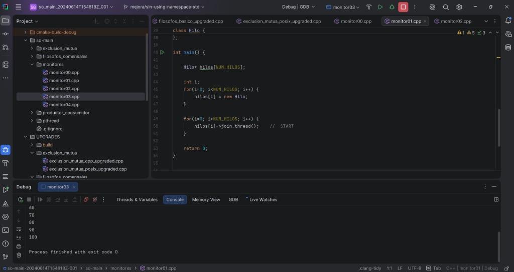
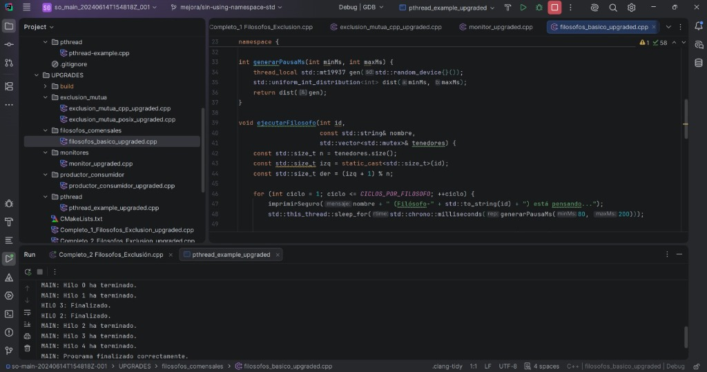
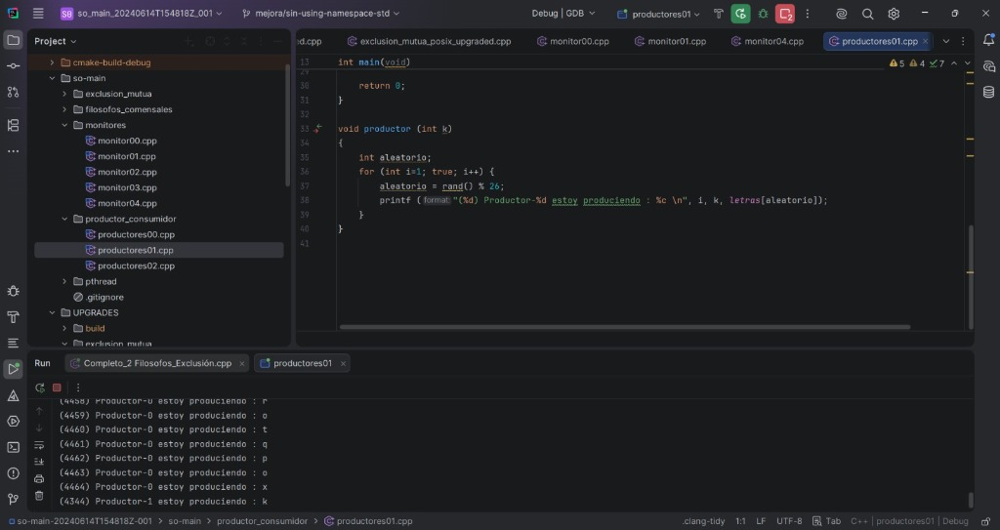
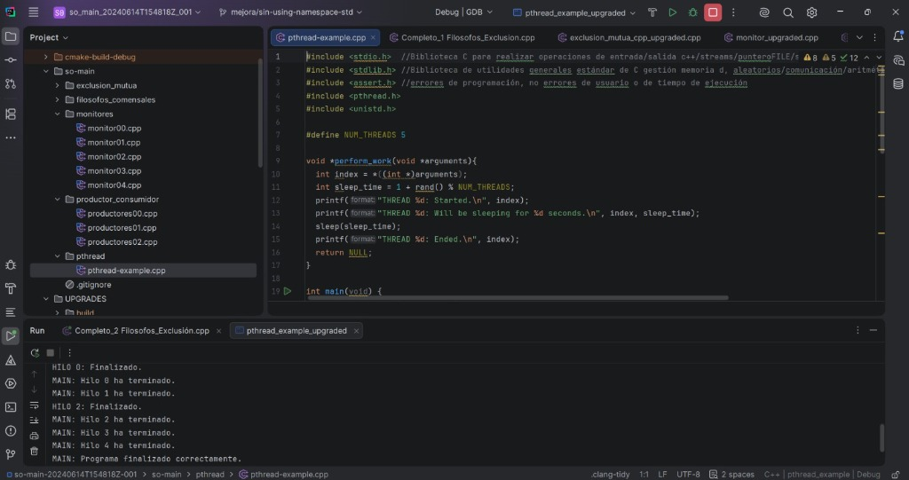

# Informe de Análisis Crítico y Mejoramiento de Código Concurrente en C/C++

**Repositorio oficial de entrega — Actividad 9**

| Campo | Detalle |
|---|---|
| **Curso** | Sistemas Operativos |
| **Semestre** | 5 |
| **Docente** | Maribel Molina Barriga |
| **Integrantes** | • **GABRIEL ANDRE PAJUELO ARANIBAR**<br>• **Armando Manuel Enriquez Eguiluz**<br>• **Victor Gabriel Lupinta Flores**<br>• **Claudio Dax Zavala Salas** |

> **Documento extenso para exposición:** [INFORME_ANALISIS_Y_MEJORAS.md](./INFORME_ANALISIS_Y_MEJORAS.md)  
> **Documentación técnica de `#include`s y detalle archivo por archivo:** [UPGRADES/GUIA_TECNICA_E_INCLUDES.md](./UPGRADES/GUIA_TECNICA_E_INCLUDES.md)

---

## Resumen Sintético del Informe

El equipo auditó, compiló y ejecutó los **19 programas fuente originales** entregados (`so-main/` y los simuladores `Completo_1` / `Completo_2`), identificando fallos críticos de sincronización, diseño, gestión de memoria, compilación CMake y codificación en consola. A partir de este análisis crítico y reflexivo se construyó la carpeta **[UPGRADES/](./UPGRADES)** con las soluciones corregidas y modernas en C++17 / POSIX.

### Síntesis por módulo evaluado

| Módulo | Diagnóstico crítico del código entregado | Solución y mejora implementada en `UPGRADES/` |
|---|---|---|
| **1. Los Filósofos Comensales**<br>(`filosofos00..04.cpp`, `Completo_1`, `Completo_2`) | • `filosofos02..04`: bucles infinitos sin tenedores ni exclusión mutua.<br>• `Completo_1`: lectura sin mutex en `while (fideos > 0)` (*data race*), `tiempoComiendo` sumaba cantidad de fideos, sin validar `numFilosofos <= 0`.<br>• `Completo_2`: **bug crítico** en `tomarTenedores()` donde `unique_lock` locales se destruían al salir del método y `dejarTenedores()` llamaba `.unlock()` sobre mutex ya liberados (*Undefined Behavior*); además el vector `tenedores` estaba fijado en `5` (`id % 5`), causando desbordamiento si `numFilos > 5`. | • [filosofos_basico_upgraded.cpp](./UPGRADES/filosofos_comensales/filosofos_basico_upgraded.cpp): ciclos finitos, consola sincronizada y tenedores con `std::scoped_lock`.<br>• [Completo_1_Filosofos_Exclusion_upgraded.cpp](./UPGRADES/Completo_1_Filosofos_Exclusion_upgraded.cpp): acceso atómico al plato bajo `std::lock_guard`, separación de porción y tiempo real, validación contra división por cero.<br>• [Completo_2_Filosofos_Exclusion_upgraded.cpp](./UPGRADES/Completo_2_Filosofos_Exclusion_upgraded.cpp): tenedores dinámicos (`numFilos >= 2`), bloqueo conjunto sin *deadlock* con `std::scoped_lock` cubriendo todo el ciclo `tomar -> comer -> dejar` y validación de `INT_MAX` con `long long`. |
| **2. Los Monitores**<br>(`monitor00..04.cpp`) | • `monitor01`: hilos sin mutex (*race condition* en `cont`).<br>• `monitor02`: `cont` y `flag` seguían globales y `cout` fuera de la sección crítica.<br>• `monitor03`: bloqueo fuera del monitor (`----ERROR`), rompiendo la encapsulación.<br>• `monitor04`: puntero `Monitor* mo;` **sin inicializar** pasado a `Hilo` (fallo de segmentación / UB).<br>• Fugas de memoria (`new` sin `delete`). | • [monitor_upgraded.cpp](./UPGRADES/monitores/monitor_upgraded.cpp): clase `MonitorContador` real con `cont`, `std::mutex` y `std::condition_variable` privados, un hilo observador que espera la meta `100` y gestión RAII mediante `std::shared_ptr` y `std::unique_ptr` (cero fugas de memoria). |
| **3. La Exclusión Mutua**<br>(`exclusionMutua00..02.cpp`) | • `00` y `01`: incremento concurrente `variable = variable + 1` sin sincronización, perdiendo actualizaciones.<br>• `02`: corrige con `pthread_mutex_t`, pero no valida retorno de funciones `pthread_*`, ni entradas inválidas en `scanf`, ni comprueba el total esperado. | • [exclusion_mutua_posix_upgraded.cpp](./UPGRADES/exclusion_mutua/exclusion_mutua_posix_upgraded.cpp): versión POSIX endurecida con verificación de errores `pthread_*`, lectura segura (`fgets` + `strtoll`) y verificación automática `variable == 5 * tope`.<br>• [exclusion_mutua_cpp_upgraded.cpp](./UPGRADES/exclusion_mutua/exclusion_mutua_cpp_upgraded.cpp): comparativa de exactitud y rendimiento (`std::chrono`) entre `std::mutex` (`std::lock_guard`) y `std::atomic<long long>`. |
| **4. Los Threads**<br>(`pthread-example.cpp`) | • Dependencia no portable de `<unistd.h>` (`sleep`) en segundos enteros.<br>• Uso de `rand()` (no *thread-safe*) sin semilla.<br>• `assert()` desaparece en compilación Release (`-DNDEBUG`). | • [pthread_example_upgraded.cpp](./UPGRADES/pthread/pthread_example_upgraded.cpp): migración portable a `std::thread` y `std::chrono::milliseconds`, generador `thread_local std::mt19937` y salida estándar protegida con `std::mutex`. |
| **5. Sólo de Productor-Consumidor**<br>(`productores00..02.cpp`) | • Solo implementaban productores en bucle infinito (`for (int i=1; true; i++)`) usando `rand()` sin búfer compartido ni hilos consumidores.<br>• `productores02`: fuga de memoria con `new Productor(i)`. | • [productor_consumidor_upgraded.cpp](./UPGRADES/productor_consumidor/productor_consumidor_upgraded.cpp): patrón completo con búfer acotado (`BufferAcotado<char>` de capacidad `5`), 2 productores, 2 consumidores, dos `std::condition_variable` (`cvNoLleno`, `cvNoVacio`), cierre ordenado `cerrar()` y verificación `totalProducido == totalConsumido`. |

### Mejoras transversales de ingeniería aplicada

1. **Asignación independiente de ejecutables en CMake**: El [CMakeLists.txt](./CMakeLists.txt) original agrupaba 17 archivos con `main()` en un solo ejecutable (imposible de enlazar). Se reestructuró para que cada `.cpp` (19 originales + 8 mejorados en [UPGRADES/CMakeLists.txt](./UPGRADES/CMakeLists.txt)) sea un proyecto independiente.
2. **Eliminación de acortadores globales (`using namespace std;`)**: Se eliminó `using namespace std;` en todos los fuentes (`Completo_2`, `monitor00..04`, `productores01..02` y en todo `UPGRADES/`), usando calificación explícita `std::` y `constexpr` en lugar de `#define` para evitar colisiones de nombres y contaminación del espacio global.
3. **Solución de codificación UTF-8 en consola Windows**: Se configuró `-finput-charset=UTF-8 -fexec-charset=UTF-8` (GCC) / `/utf-8` (MSVC) en CMake y `SetConsoleOutputCP(CP_UTF8)` / `SetConsoleCP(CP_UTF8)` en tiempo de ejecución para eliminar caracteres ilegibles en tildes, `ñ`, `°` y `¿`.

---

## Evidencias de Ejecución y Mejora (Capturas en CLion)

### 1. Ejecución de Monitores originales (`monitor03` / `monitor01.cpp`)
Se evidencia la ejecución del código original de monitores con `monitor03` en consola (`60, 70, 80, 90, 100`) y la estructura de `monitor01.cpp` con fugas de memoria (`new Hilo`) y ausencia de exclusión mutua encapsulada.



### 2. Ejecución de Threads mejorados (`pthread_example_upgraded`) y código de `filosofos_basico_upgraded.cpp`
Se observa la ejecución limpia de `pthread_example_upgraded` sin líneas mezcladas ni dependencias POSIX no portables, junto con la implementación moderna de Filósofos Comensales usando `thread_local std::mt19937` y calificación explícita `std::` (sin `using namespace std;`).



### 3. Ejecución original de Productor (`productores01`) en bucle infinito
Se evidencia que `productores01.cpp` únicamente ejecutaba un ciclo infinito sin consumidor ni búfer acotado, motivando el diseño completo con `BufferAcotado` y `std::condition_variable` en `productor_consumidor_upgraded.cpp`.



### 4. Comparativa directa de Threads: `pthread-example.cpp` original vs `pthread_example_upgraded`
Se muestra el código original en C (`<unistd.h>`, `rand()`, `printf`) frente a la ejecución estable del programa mejorado en C++17.



---

## Estructura del Repositorio

```text
.
├── CMakeLists.txt                              # 27 ejecutables independientes (19 originales + 8 UPGRADES)
├── README.md                                   # Resumen sintético del informe (este archivo)
├── INFORME_ANALISIS_Y_MEJORAS.md               # Informe crítico y reflexivo completo para exposición
├── .gitignore                                  # Reglas de exclusión para C/C++, CMake, CLion e IDE
├── Completo_1 Filosofos_Exclusion.cpp          # Simulador original 1
├── Completo_2 Filosofos_Exclusión.cpp          # Simulador original 2 (sin using namespace std)
├── capturas/                                   # Capturas de evidencia en CLion
├── so-main/                                    # Códigos base originales por módulo
│   ├── exclusion_mutua/
│   ├── filosofos_comensales/
│   ├── monitores/
│   ├── productor_consumidor/
│   └── pthread/
└── UPGRADES/                                   # Versiones mejoradas y documentación técnica
    ├── CMakeLists.txt
    ├── README.md
    ├── GUIA_TECNICA_E_INCLUDES.md
    ├── Completo_1_Filosofos_Exclusion_upgraded.cpp
    ├── Completo_2_Filosofos_Exclusion_upgraded.cpp
    ├── exclusion_mutua/
    ├── filosofos_comensales/
    ├── monitores/
    ├── productor_consumidor/
    └── pthread/
```

---

## Compilación y Ejecución Rápida

Desde CLion, cada archivo aparece como un objetivo independiente en el selector de ejecución. También puede compilarse todo desde terminal con CMake:

```powershell
cmake -S . -B cmake-build-debug -G Ninja
cmake --build cmake-build-debug
```

---

## Conclusiones del Equipo

1. **La concurrencia sin sincronización es no determinista y peligrosa**: Los errores en `exclusionMutua00/01` y `monitor01` demuestran que operaciones aparentemente simples como `cont++` pierden datos bajo múltiples hilos; el uso de `std::mutex` con **RAII** (`std::lock_guard`, `std::scoped_lock`) o `std::atomic` elimina estas condiciones de carrera de raíz.
2. **El manejo manual de cerrojos induce fallos sutiles**: El análisis de `Completo_2 Filosofos_Exclusión.cpp` reveló que un `unique_lock` destruido al salir de una función invalida la exclusión mutua y provoca comportamiento indefinido al llamar `.unlock()` después. **RAII** y `std::scoped_lock` resuelven tanto el ciclo de vida como el riesgo de interbloqueo (*deadlock*).
3. **La encapsulación define a un Monitor real**: Un monitor no es solo una clase junto a variables globales (`monitor02/03/04`); debe encapsular internamente el estado compartido, el mutex y las `condition_variable`, evitando además fugas de memoria mediante punteros inteligentes (`std::shared_ptr`, `std::unique_ptr`).
4. **La calidad del código incluye portabilidad y claridad**: Separar los objetivos en CMake, prescindir de `using namespace std;`, reemplazar `rand()` por `thread_local std::mt19937` y asegurar la salida `CP_UTF8` en Windows transformó ejercicios académicos aislados en software concurrente limpio, compilable sin advertencias y verificable.
